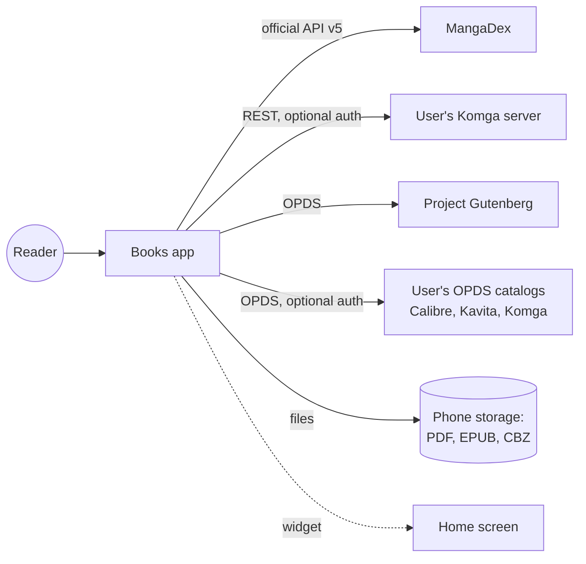
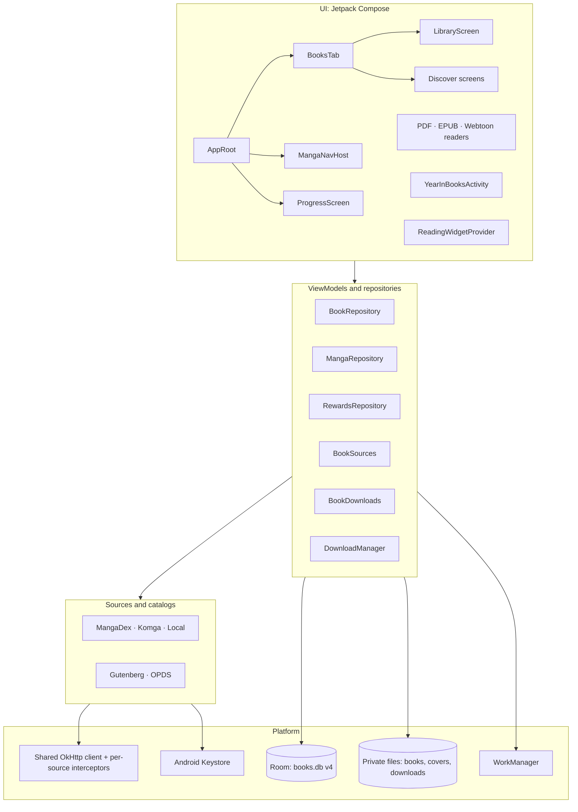
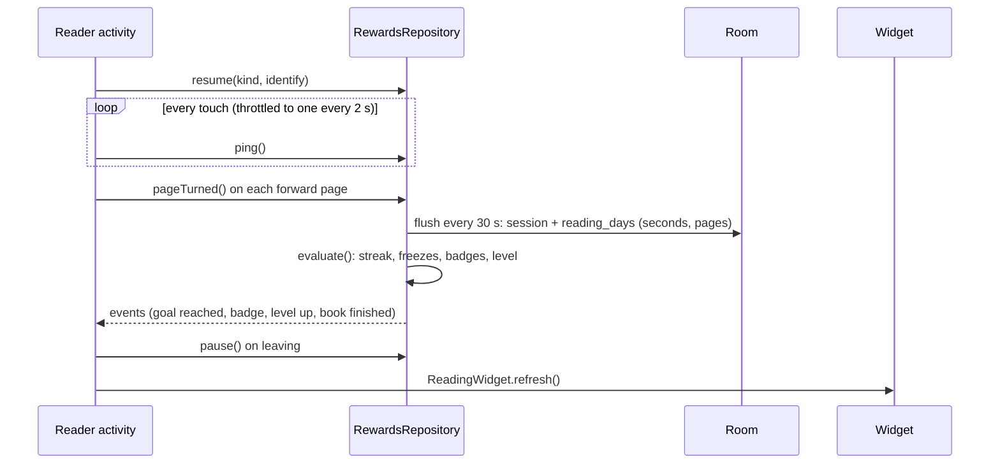
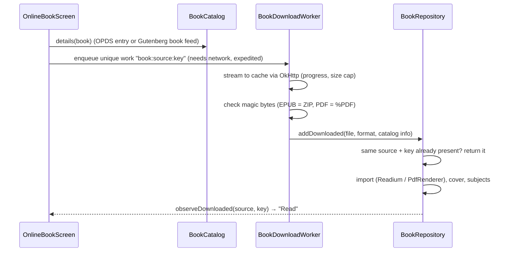

# Books: high-level design

Books is a single-module Android app (Kotlin, Jetpack Compose) with three tabs: **Books** (PDF and EPUB, plus online discovery), **Manga** (online sources, downloads, a webtoon reader) and **Progress** (streaks, rewards, Year in Books). It has no backend: everything runs and is stored on the phone, and the only network traffic goes to the sources and catalogs the user chooses.

## Goals and constraints

- **Reading first.** Readers open instantly, scroll smoothly, stay crisp at any zoom, and remember the exact spot.
- **Private.** No accounts, analytics, ads or third-party SDKs. Secrets are encrypted with the Android Keystore and sent only to the host they belong to.
- **Fair use.** Sources use documented APIs or servers the user controls. No scraping, no paywall or anti-bot workarounds, no downloaded extension code. Catalogs offer only free downloads.
- **Durable data.** Database changes are additive migrations tested against exported schemas; an upgrade never loses a book, bookmark, chapter or streak.
- **Light on the battery.** Background work goes through WorkManager with constraints: no wake locks, no polling, no periodic widget updates.

## System context

## Layers

`BooksApp` holds the app-wide singletons, each created lazily on first use: `database`, `repository`, `readerSettings`, `rewards`, `manga` (`MangaModule`) and `discover` (`DiscoverModule`). Opening the library never creates the online modules.

## Packages

| Package | Responsibility |
|---|---|
| `data/` | Room database (entities, DAOs, migrations), `BookRepository` (import, downloaded books, covers), reader settings, Readium setup |
| `library/` | Library screen; `BooksTab` and the Books tab's navigation (library → Discover) |
| `reader/` | PDF reader (`PdfRenderer` + Compose pager, region re-rendering when zoomed), EPUB reader (Readium navigator fragment + Compose chrome), shared reader chrome |
| `discover/` | Online books: `opds/` parser, `catalog/` (Project Gutenberg, generic OPDS), `BookSources` registry, `BookDownloads` + worker, `ui/` screens |
| `manga/` | `data/` (series, chapters, history, downloads), `source/` (API, MangaDex, Komga, local files, networking, credentials), `download/` (queue, worker, library updates, notifications), `reader/` (webtoon reader), `ui/` |
| `rewards/` | Reading-time tracking, streaks, badges, levels, perks, app icons, reminder worker, Progress screen and in-reader celebrations |
| `year/` | Year in Books: `YearRecaps` (a pure function over recorded rows), ViewModel, story screens, sharing |
| `widget/` | The "Reading" home-screen widget: data loading, RemoteViews rendering, refresh scheduling |
| `ui/` | Theme, covers (`BookCover`, `CoverCache`), press feedback, navigation transitions |

## Data model (Room, version 4)

| Table | Holds | Since |
|---|---|---|
| `books` | Imported or downloaded books: file, cover flag, progress, resume location, source and source key, subjects | v1 (source and subjects added in v4) |
| `bookmarks` | Bookmarks per book (cascade on delete) | v1 |
| `manga_sources` | Configured manga sources (settings JSON, never secrets) | v2 |
| `manga_series`, `manga_chapters` | Series and chapters with read state and exact page position | v2 |
| `manga_history`, `manga_downloads` | Last chapter read per series; download queue and progress | v2 |
| `reading_sessions` | One row per reading stretch: item, active seconds, pages turned | v3 (pages added in v4) |
| `reading_days` | Per-day totals: seconds, goal met, frozen, pages turned. The source of truth for streaks and XP | v3 (pages added in v4) |
| `earned_badges`, `finished_items` | Badges, and books, chapters and series finished (recorded once) | v3 |
| `book_sources` | Online book catalogs: Project Gutenberg plus user-added OPDS catalogs (no secrets) | v4 |

Migrations (`data/Migrations.kt`) are hand-written and **additive only**: new tables, and new columns with defaults. Every version's schema is exported to `app/schemas/`, and `MigrationTest` checks each step (1→2→3→4) against it, with real rows carried across.

## Key flows

### Reading and rewards

- Time counts only while the reader is used: gaps between touches are capped at 2 minutes.
- All rewards work runs on one ordered dispatcher, so a ping can never overtake the resume before it.
- XP is **derived** from stored rows (minutes, chapters, books, series, goal days, badges), never kept as a running total, so it can't drift. Unlocks use the highest level ever reached (`lastLevel`), so they're permanent.
- The day rolls over at local midnight: a coroutine waits until then (holding no wake lock), and `refreshDay()` runs whenever a reader or the Progress tab resumes.

### Online book download

### Webtoon reader

The reader is a `LazyColumn` of rows: chapter headers, pages and an end marker. Each page is split by `StripPlanner` into strips no taller than one screen, and each strip is decoded with `BitmapRegionDecoder`, so a 20,000 px image never needs one huge bitmap. A strip is decoded at the smallest power-of-two sample that's still at least screen-wide, then scaled once to exactly the screen width. Decoded strips live in a byte-bounded LRU, which is trimmed when the app goes into the background. `PageLoader` reads downloaded chapters from disk, fetches others into a size-bounded cache, and re-requests short-lived page URLs once. The next chapter loads as you near the end and flows on seamlessly.

### Widget

`ReadingWidgetProvider` uses RemoteViews, not Glance: there's no extra dependency, and updates are pushed directly. On Android 12+ it supplies small, medium and large layouts and the launcher picks the one that fits; older versions choose from the widget's size options. It redraws only when something it shows may have changed (a reader closes, a book is removed, the goal changes), plus once after midnight through an inexact, non-waking `AlarmManager.RTC` alarm. It also redraws when the time zone or clock changes.

## Networking and security

- **One `OkHttpClient`** (`MangaNetwork.base`) shares a connection pool, a 32 MB HTTP cache and the User-Agent. Each source builds its own client from it, with its own interceptors.
- **Rate limits per source**: MangaDex 4 requests/s for the API and 40/min for its at-home server lookups (its documented limits), Project Gutenberg 2 requests/s, and `Retry-After` honoured.
- **Credentials** for Komga and OPDS catalogs are AES-GCM encrypted with a key that never leaves the Android Keystore. `HostAuthInterceptor` adds them only to requests for that source's own host, and cover images get the sign-in only when they're on that host.
- **XML from catalogs** is parsed with DTDs and external entities refused.
- **Only free acquisition links** (`acquisition`, `acquisition/open-access`) are offered, and a download must really be an EPUB or PDF.
- **Cleartext HTTP** is allowed only so home servers on a local network work, and the app warns before saving a non-HTTPS address outside one.

## Performance design

| Area | Approach |
|---|---|
| Library covers | Decoded at the size shown (400 px) into a byte-bounded LRU; neutral placeholder while loading |
| PDF pages | Rendered at screen width on a single-threaded renderer; when zoomed, only the visible region is re-rendered at screen resolution |
| Webtoon images | Region decoding a screen at a time, scaled to screen width, `prepareToDraw()` off the main thread, LRU trimmed on `onTrimMemory` |
| Startup | Online modules and the Books-tab navigation host are created only when first used |
| Background | WorkManager only, with network and battery constraints; library checks are opt-in; no periodic widget updates |
| Screen | Kept awake while reading, released after 10 idle minutes |

Measurements are in [benchmark.md](benchmark.md).

## Testing

| Suite | Covers |
|---|---|
| Unit (`app/src/test`) | MangaDex and Komga sources against MockWebServer, the local source, rate limiting, natural ordering, strip planning, resume targets, streak/badge/level rules, perks, the OPDS parser (including hostile XML), Project Gutenberg and OPDS catalogs, the Year in Books engine |
| Instrumented (`app/src/androidTest`) | Every migration step against exported schemas, manga DAOs, the download processor, the rewards repository (midnight rollover, page counting, throttling, permanent unlocks), adding downloaded books |

## Releases

Pushing a `vX.Y.Z` tag runs `.github/workflows/release.yml`. It builds the release APK signed with the project key (from repository secrets) and attaches it to a GitHub Release. `versionCode` is `major × 10000 + minor × 100 + patch`, so every tag installs over the last.
